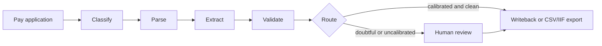

# Ledger Sense

Document intelligence with confidence routing, for construction progress billing.

Ledger Sense extracts, validates and routes construction pay-application data
(quantities, retainage, stored materials, change orders) with a deterministic
pipeline first and a tightly fenced, opt-in model escalation second. Every
extracted field carries a `Claim` with a method and a confidence score, and
nothing routes past review until that confidence is calibrated against ground
truth.

[](https://github.com/Berakhah/ledger-sense/actions/workflows/ci.yml) [](LICENSE)

## How this was built

I designed it, wrote the specifications with Claude Code, set the evaluation criteria, directed the implementation, and reviewed and tested the changes. Claude Code generated a substantial part of the code under my direction. Counted on 7 Nov 2026: 252 of 267 commits were made through my second account, [@Berakhah-sys](https://github.com/Berakhah-sys), and 238 carry a `Co-Authored-By: Claude` trailer. The self-audit in `docs/` is my own review of this code, not a third-party one. The first commit was originally dated 11 Mar 2025, and its spec files carried that date in their names. The date was wrong: the commit is co-authored by Claude Opus 5, which didn't exist then, and its plans refer to August 2026. On 4 Nov 2026 I re-dated it to one hour before the second commit (29 Aug 2026) and renamed the files; the follow-up commit says so.

## How a document moves through it



## Status and known limitations

The [15 October 2026 self-audit](docs/system-audit-2026-10-15.md) assessed this as an engineering prototype, not yet ready for client accounting writeback. Fixes have landed since, and these findings were still open when last checked on 4 November 2026:

- **LS-11:** extraction still runs outside the parser's resource boundary.
- **LS-12:** the parser queue can reject valid text-rich PDFs.
- **LS-14:** reconciliation reads demo-only state.
- **LS-15:** baseline studies aren't durable or resumable yet.
- **LS-34:** QuickBooks reversal has no durable recovery.
- **LS-16 to LS-33:** all 18 Medium findings from the self-audit.

Of the 16 Critical and High findings, 11 have fix commits (LS-01, the cross-tenant bug, was fixed in commit 2feb706); the five above are still open.

The synthetic corpus is the demo. There are no published results on real documents.

## Quickstart

```bash
cp .env.example .env
docker compose --profile demo up
```

The `demo` profile runs entirely on the synthetic corpus (`SYNTHETIC` data
class) and mounts no client volume — safe to run anywhere. The `client`
profile is for a design partner's real documents (`CLIENT_CONFIDENTIAL`); its
Postgres is always the container in this compose file, never a hosted
service — **your documents never leave your infrastructure**.

Under `demo`, and only under `demo`, the API mounts `POST /api/fixtures/seed`
so the browser suite can mint the synthetic documents it navigates to. Under
`client` that route does not exist — compose runs a different API service
(`app-demo` vs `app`) rather than flipping an environment variable, so which
one you are running is a property of what started, not of what you remembered
to export.

## Frontend

The Next.js app lives in `ledger_sense/web` and is driven from one node
project at the repo root — one `package.json`, one lockfile.

```bash
npm install
npm run dev     # http://localhost:3000, expects the API on :8000
npm test        # vitest — unit and component
npm run test:e2e  # playwright; brings up the compose demo profile itself
```

`npm run dev`/`npm run build` first copy the `pdf.js` worker out of the pinned
`pdfjs-dist` into `public/`. No CDN, for the same reason fonts are self-hosted:
the demo has to run offline, and a request for the worker that renders a pay
application tells someone else's server which document is being read.

## Data handling

- `CLIENT_CONFIDENTIAL` documents never reach a free-tier or third-party
  model. The optional model-escalation lane accepts `SYNTHETIC` or
  `REDACTED` input only.
- Writeback never approves or pays. QuickBooks Online has no draft state for
  Bills, so a QBO write creates an **unpaid** Bill, stamped `AWAITING REVIEW`,
  that posts to Accounts Payable at once. Ledger Sense never creates a
  BillPayment; a human approves by paying the Bill inside QuickBooks. The CSV/IIF
  export is the staging path with no ledger effect until the client imports it.
- No AIA form artifact — G702/G703 are copyrighted and actively enforced.
  The synthetic corpus and UI use our own layout with equivalent column
  semantics.

## Notice

Not developed, endorsed, approved, sponsored by, or affiliated with the American Institute of Architects. AIA®, G702® and G703® are registered trademarks of the American Institute of Architects. References describe format compatibility only.

## Licence

Apache License 2.0 — see [`LICENSE`](LICENSE).

## Security

See [`SECURITY.md`](SECURITY.md) for how to report a vulnerability.

## Contributing

See [`CONTRIBUTING.md`](CONTRIBUTING.md).
